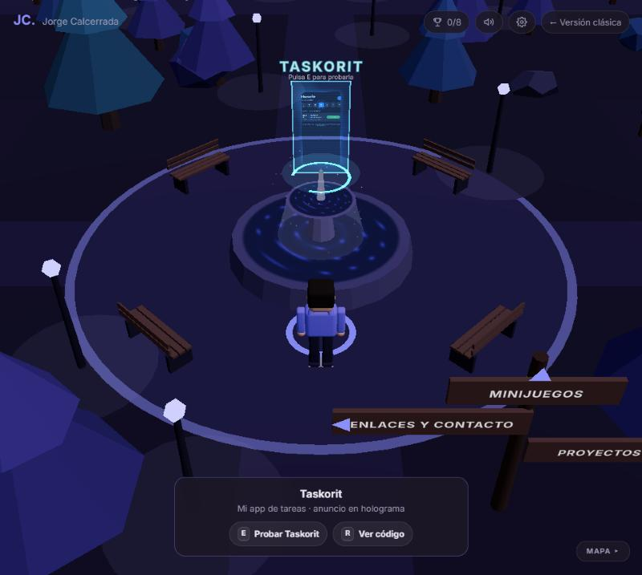

# Portafolio 3D · Jorge Calcerrada

Habitación de desarrollador → mundo abierto explorable con proyectos, enlaces y zonas de minijuegos.
React + React Three Fiber + drei + Rapier, empaquetado con Vite.

👉 **[Jugar en el navegador](https://jorge-calcerrada.expo.app/3d/)** · versión clásica: https://jorge-calcerrada.expo.app/

<p align="center">
  
</p>

```bash
npm install
npm run dev       # desarrollo
npm run build     # build de producción en dist/
```

Despliegue: se compila con `base: '/3d/'` y se publica dentro del portfolio (repo [portfolio](https://github.com/calcerritor3000/portfolio)) con `npm run sync:3d` y `npm run deploy` desde allí.

## Dónde se cambia cada cosa

| Qué | Archivo |
| --- | --- |
| Bio, proyectos, enlaces, CV, minijuegos, avatar | `src/content.js` |
| Colores (fondo, acento) y tipografías | `src/theme.js` |
| Habitación inicial | `src/scene/Room.jsx` |
| Mundo, carteles, zonas, árboles | `src/scene/World.jsx` |
| Mapa (posición de cada zona) | `src/scene/layout.js` |
| Decoración del mundo (fuente, hoguera, estanque…) | `src/scene/Decor.jsx` |
| Decoración de la habitación (gato, reloj, PC…) | `src/scene/RoomDecor.jsx` |
| Minijuegos | `src/scene/games/Football.jsx`, `src/scene/games/Bowling.jsx` |
| Holograma de Taskorit sobre la fuente (vídeo en `public/videos/`) | `src/scene/Hologram.jsx` |
| Sonidos (generados con Web Audio, sin archivos) | `src/audio/sfx.js` |
| Movimiento del avatar | `src/scene/Player.jsx` |
| Cámara | `src/scene/CameraRig.jsx` |

- Avatar: exportar un `.glb` low-poly comprimido con Draco a `public/models/` y poner su ruta en `avatar.modelUrl`.
- `?debug` en la URL muestra FPS y los tiempos de cada fase de carga en la consola; `?physics` dibuja las colisiones.

## Controles

WASD / flechas para moverte · Shift para correr · Espacio para saltar · E para interactuar · mantener E junto a un balón carga el chut, soltar chuta · M silencia el sonido.

## Minijuegos

- **Reto de goles**: pulsa E en el círculo de la entrada del campo. 60 s contra un portero que se mueve y sigue el balón; récord guardado en el navegador.
- **Bolos**: chuta la bola por la pista. 5 tiradas, strike con confeti, récord guardado.

## Extras

- **Calidad gráfica** automática (baja sola si van mal los FPS) o manual en Ajustes (⚙). En calidad baja se quitan sombras, luces puntuales, hierba y partículas.
- **Móvil**: joystick (arrastrar en la mitad izquierda) y botones *Saltar* / *Acción* (mantener para cargar el chut).
- **Minimapa** abajo a la derecha: clic en un punto para viajar. En móvil en horizontal empieza cerrado y se cierra al viajar.
- **Holograma de Taskorit** flotando sobre la fuente de la plaza: reproduce el anuncio de la app (solo cuando estás cerca) y con E abre la demo.
- **Intro** de cámara al entrar (cualquier tecla o toque la salta).
- **Logros** (🏆 arriba a la derecha), guardados en el navegador.
- **Música** opcional y **día/noche** en Ajustes.
- Capturas de proyectos en `public/projects/` (`image` en `content.js`); los que no tienen captura muestran una ilustración generada (`art: 'qr' | 'map' | 'clock'`).

## Licencia

[MIT](LICENSE) © calcerritor3000
